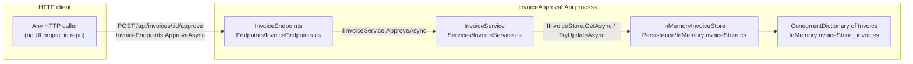
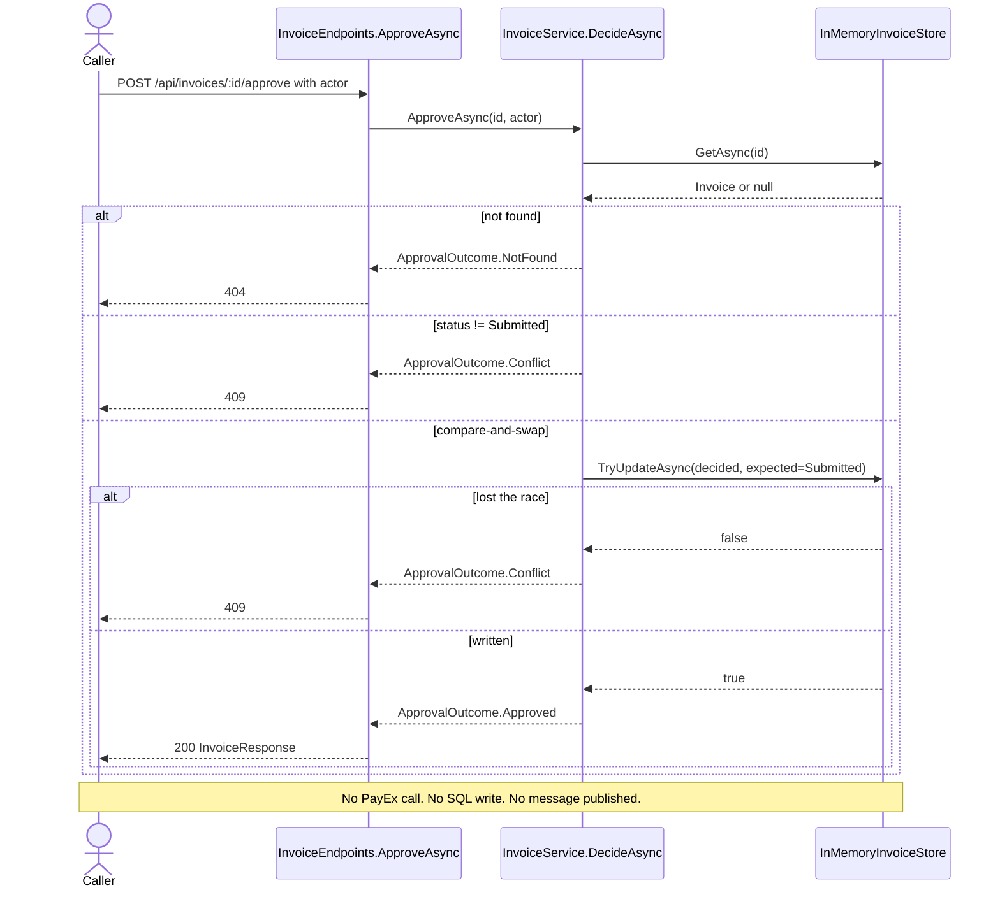
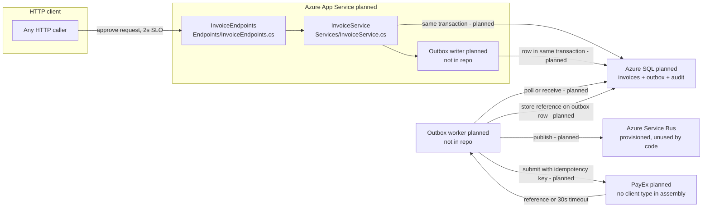

# 1. As-built diagrams, citations, inferences, target state

Mermaid source:

- `diagrams/as-built-container.mmd`
- `diagrams/as-built-sequence.mmd`
- `diagrams/target-container.mmd`

The Mermaid MCP named in the brief was not available in this workspace. The diagrams were written as Mermaid source and checked against the symbols they cite. Wrong inferences were removed rather than left in the picture.

## As-built container (what the process does today)



## As-built sequence (approval path)



## Citation list (every as-built element)

| Element | Citation |
| --- | --- |
| HTTP surface for approve | `InvoiceEndpoints.ApproveAsync` in `src/InvoiceApproval.Api/Endpoints/InvoiceEndpoints.cs` |
| Route | `MapPost("/{id:guid}/approve")` on group `/api/invoices` |
| Use-case | `InvoiceService.ApproveAsync` → `DecideAsync` in `src/InvoiceApproval.Api/Services/InvoiceService.cs` |
| Persistence port | `IInvoiceStore` in `src/InvoiceApproval.Api/Persistence/IInvoiceStore.cs` |
| Persistence adapter | `InMemoryInvoiceStore` in `src/InvoiceApproval.Api/Persistence/InMemoryInvoiceStore.cs` |
| In-process collection | `ConcurrentDictionary<Guid, Invoice> _invoices` |
| Domain type | `Invoice` / `InvoiceStatus` in `src/InvoiceApproval.Api/Domain/` |
| Compare-and-swap | `IInvoiceStore.TryUpdateAsync(invoice, expectedStatus)` |
| Composition root | `Program.cs` registers `AddSingleton<IInvoiceStore, InMemoryInvoiceStore>()` |
| Health truth | `GET /health` returns `persistence=in-memory`, `payex=not-integrated` |
| Test lock on this shape | `tests/InvoiceApproval.ArchitectureTests/PersistenceBoundaryTests.cs` |

## Inferred items (not in the as-built diagram)

These were guessed and then checked. They stay out of the as-built picture.

| Guess | Check | Verdict |
| --- | --- | --- |
| There is a web UI | No `*.cshtml`, no SPA project, no frontend folder | Inferred, false |
| Approvals are authenticated | `InvoiceEndpoints` maps routes with no `RequireAuthorization` | Inferred as "internal tool leftover", true as a gap, not a component |
| Azure SQL is already wired | No `Microsoft.Data.SqlClient` / EF package; store is in-memory | Inferred, false for as-built |
| Service Bus is used | No `Azure.Messaging.ServiceBus` reference | Provisioned in ops, unused in code |
| PayEx is called on approve | No PayEx type in the assembly; architecture test forbids one | Inferred, false |
| App Service / IIS hosting | `Program.cs` is a generic host; App Service is the planned host | Inferred for today, false |
| A queue already exists between approve and payment | Nothing publishes | Inferred, false |

The first draft of the container view put Azure SQL and PayEx on the as-built picture because `ops/README.md` names them. That draft was wrong. Ops describes the January deployment. The code does not.

## Target state (persistence + PayEx)

Planned parts are marked `<<planned>>`. Service Bus is real in the subscription and unused by this repository.



What does not exist yet: Azure SQL schema, outbox writer, outbox worker, PayEx client, seven-year audit table, authentication on the mutating routes. What exists and is unused: the Service Bus namespace (`ops/evidence/platform.md`).

## Architecture test

**Rule:** invoice mutation on the request path goes through `IInvoiceStore`. `InvoiceService` and `InvoiceEndpoints` must not own a collection, a SQL client, or a PayEx/`HttpClient`. The assembly must not contain a PayEx client type. `InvoiceService` must take `IInvoiceStore`, not `InMemoryInvoiceStore`.

**Command:**

```bash
dotnet test tests/InvoiceApproval.ArchitectureTests/InvoiceApproval.ArchitectureTests.csproj
```

The test is `PersistenceBoundaryTests` in `tests/InvoiceApproval.ArchitectureTests/PersistenceBoundaryTests.cs`. One test that runs is the deliverable; unit tests of approve/conflict sit beside it and are not the architecture test.
